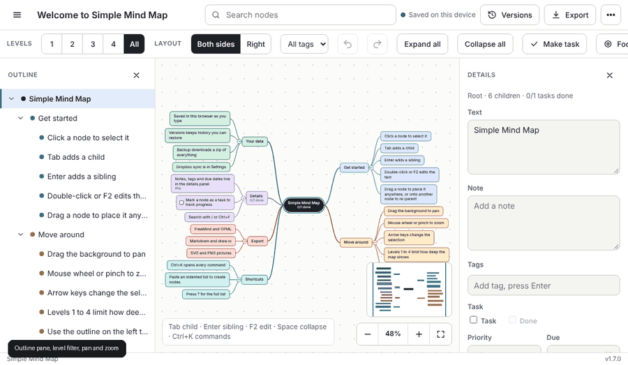

# Simple Mind Map

**Live app: https://adambeltz2.github.io/simple-mind-map/**

A mind-map tool that runs entirely in your browser. One HTML file, no build step, no server, works offline, and installs as an app on your phone or computer. Your maps stay on your device unless you turn on Dropbox sync.

## Features

### Edit and navigate
| Feature | What it does |
|---|---|
| Outline pane | A collapsible tree beside the map. Click to jump to a node, and it follows your selection |
| Level filter | Buttons 1, 2, 3, 4 and All show only the top levels of the map |
| Search | Press `/` or `Ctrl+F` to highlight matching nodes and dim the rest |
| Collapse and expand | Per branch, or all at once, with a `+N` badge on hidden children |
| Focus branch | Show only the selected branch, with a breadcrumb back |
| Tag filter | Show only nodes with a chosen tag |
| Pan and zoom | Drag the background, mouse wheel, pinch, fit-to-view and a minimap |
| Two layouts | Both sides of the center, or all to the right |

### Structure and content
| Feature | What it does |
|---|---|
| Fast keyboard editing | `Tab` adds a child, `Enter` adds a sibling, `F2` or double-click edits |
| Drag to restructure | Drop on a node's middle to make a child, or on its top or bottom edge to reorder |
| Free placement | Drop a node on empty space to leave it there, with its whole branch. Positions are saved. Reset from the right-click menu |
| Tasks | `T` makes a node a task, `X` marks it done. Parents show a done count |
| Notes, tags, colors | In the Details panel. Branch colors, due date and priority too |
| Undo and redo | `Ctrl+Z` and `Ctrl+Shift+Z`, up to 200 steps |
| Paste as nodes | Paste an indented list or Markdown to create a branch |
| Edit JSON | A live JSON editor with validation and find and replace on node names, for bulk renames |
| Command palette | `Ctrl+K` lists every command |

### Data, history and sync
| Feature | What it does |
|---|---|
| Auto-save | Saved on this device as you type |
| Version history | Automatic snapshots (every edit burst, kept hourly for a day, daily for 30 days), named versions kept forever, a change summary and one-click restore |
| Backup and restore | One zip with every map and its history |
| Dropbox sync | Sign in once. Maps and version history sync across your devices. Conflicts keep both copies |

### Import and export
| Format | Export | Import |
|---|---|---|
| Simple Mind Map JSON (`.smm.json`) | Yes, keeps positions | Yes |
| FreeMind (`.mm`) | Yes | Yes |
| OPML | Yes | Yes |
| Markdown | Yes | Yes |
| CSV | Yes: one row per parent and child, with task Open or Closed | No |
| draw.io | Yes, editable in diagrams.net | No |
| SVG and PNG | Yes | No |

## Install on your phone or computer
Open the live app, then use your browser's **Add to Home screen** or **Install** option. After the first load it works offline.

## Dropbox sync
The app already includes a Dropbox app key. To connect, open the **⋯** menu, choose **Settings and sync**, and click **Connect**. Maps are stored in your Dropbox under `Apps/<app name>/maps/`, version history under `history/`, and backups under `backups/`.

To use your own Dropbox app instead:
1. Create an app at https://www.dropbox.com/developers/apps (Scoped access, App folder).
2. Permissions: `files.content.read` and `files.content.write`, then Submit.
3. Add your site URL as a Redirect URI, for example `https://adambeltz2.github.io/simple-mind-map/` with the trailing slash.
4. Paste its App key into Settings and sync.

Google Drive is not supported yet.

## Keyboard shortcuts
`Tab` child · `Enter` sibling · `F2` edit · `Space` collapse · `T` task · `X` done · `/` search · `Ctrl+K` commands · `Ctrl+Z` undo · `?` full list

## Host your own copy
1. Put these files in a GitHub repo.
2. Settings, Pages, deploy from branch `main` and root.
3. Open `https://<user>.github.io/<repo>/`.

## Releasing a change
Bump `APP_VERSION` in `index.html` and `VERSION` in `sw.js` together. The version shows in the footer, and installed copies refresh after a reload or two.
